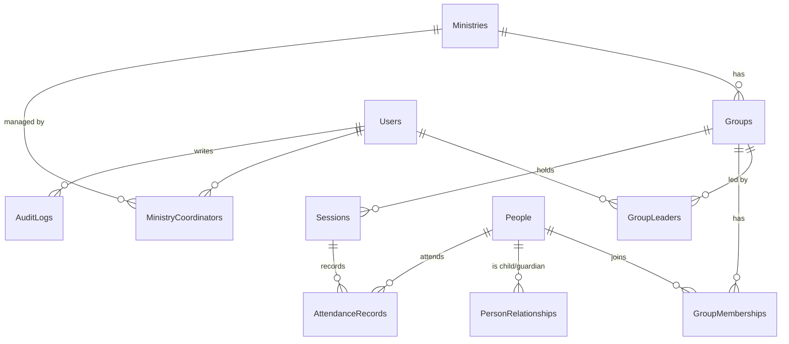

# 資料表設計（初稿）

標示「預留」的欄位已建立在資料庫，但目前沒有畫面使用。先建好是為了在正式資料進來前把結構定下來，減少之後的 Migration。

## ER 圖

## 資料表

### Users（ASP.NET Core Identity 的 AspNetUsers 擴充）
| 欄位 | 型別 | 說明 |
|---|---|---|
| Id | string | Identity 主鍵 |
| UserName / Email / PasswordHash … | | Identity 內建 |
| DisplayName | nvarchar(50) | 顯示名稱 |
| IsActive | bit | 停用後無法登入 |
| CreatedAt | datetimeoffset | |
| PersonId | int FK null | 預留：帳號對應的人員資料（同工本身也是 People 的一筆） |

角色使用 Identity 的 AspNetRoles：`Admin`、`Coordinator`、`Leader`。
Google / LINE 登入使用 Identity 內建的 AspNetUserLogins（已建立），不需額外欄位。

### Ministries 事工
| 欄位 | 型別 | 說明 |
|---|---|---|
| Id | int PK | |
| Name | nvarchar(50) | 兒童主日學、青少年… |
| SortOrder | int | |
| IsActive | bit | |

### MinistryCoordinators 主責同工負責的事工
| UserId | MinistryId | PK(UserId, MinistryId) |
|---|---|---|

### Groups 群組（班級 / 小組）
| 欄位 | 型別 | 說明 |
|---|---|---|
| Id | int PK | |
| MinistryId | int FK | |
| Name | nvarchar(50) | 第一堂兒童班 |
| Description | nvarchar(200) | |
| DefaultDayOfWeek | int null | 預設聚會星期 |
| DefaultStartTime | time null | 預設聚會時間 |
| SortOrder | int | 顯示順序 |
| MinGrade / MaxGrade | int null | 預留：適用年級，供依年級分班、批次升班 |
| IsActive | bit | |

### GroupLeaders 老師負責的群組
| UserId | GroupId | PK(UserId, GroupId) |
|---|---|---|

### People 人員（學生、家長、成人成員共用）
| 欄位 | 型別 | 說明 |
|---|---|---|
| Id | int PK | |
| Name | nvarchar(50) | 必填 |
| Nickname | nvarchar(50) null | 小名 / 英文名 |
| Gender | tinyint null | 0 未填 / 1 男 / 2 女 |
| BirthDate | date null | |
| Phone | varchar(20) null | |
| Email | nvarchar(100) null | |
| FirstVisitDate | date null | 第一次來的日期，新朋友統計用 |
| ConsentAt | datetimeoffset null | 家長同意時間 |
| ConsentMethod | nvarchar(20) null | Paper / App |
| Notes | nvarchar(500) null | |
| SchoolEntryYear | int null | 入學年度：讀小一那年的學年度（西元），見下方「年級」 |
| School | nvarchar(50) null | 預留：就讀學校 |
| Address | nvarchar(200) null | 預留：地址 |
| LineId | nvarchar(50) null | 預留：LINE ID |
| MedicalNotes | nvarchar(500) null | 預留：健康 / 過敏，僅限 `ViewSensitiveInfo` 權限查看 |
| ExternalId | nvarchar(50) null | 預留：外部編號，批次匯入時對應既有資料（有索引） |
| CustomFields | nvarchar(max) null | 同工可自訂的延伸欄位（JSON，以 ISJSON 檢查約束確保格式；不用原生 json 型別，才能相容 SQL Server 2022） |
| IsActive | bit | |
| CreatedAt / CreatedBy / UpdatedAt / UpdatedBy | | |
| RowVersion | rowversion | 併發控制 |

### PersonRelationships 人員關係
| 欄位 | 型別 | 說明 |
|---|---|---|
| PersonId | int FK | 孩子 |
| RelatedPersonId | int FK | 家長 / 監護人 |
| RelationType | tinyint | 1 父 / 2 母 / 3 其他監護人 |
| IsPrimaryContact | bit | 主要聯絡人 |

PK(PersonId, RelatedPersonId)

### GroupMemberships 群組成員資格（有起訖，保留歷史）
| 欄位 | 型別 | 說明 |
|---|---|---|
| Id | int PK | |
| GroupId | int FK | |
| PersonId | int FK | |
| StartDate | date | |
| EndDate | date null | null = 目前仍在群組 |

索引：(GroupId, EndDate)、(PersonId)

### Sessions 聚會場次
| 欄位 | 型別 | 說明 |
|---|---|---|
| Id | int PK | |
| GroupId | int FK | |
| SessionDate | date | |
| StartTime | time null | |
| Title | nvarchar(50) null | 特別聚會名稱，一般主日留空 |
| IsCancelled | bit | 停課不計入統計 |
| Notes | nvarchar(500) null | 預留：聚會主題、停課原因 |

唯一索引：(GroupId, SessionDate, StartTime)

### AttendanceRecords 點名紀錄
| 欄位 | 型別 | 說明 |
|---|---|---|
| Id | bigint PK | |
| SessionId | int FK | |
| PersonId | int FK | |
| Status | tinyint | 1 出席 / 2 缺席 / 3 請假 |
| IsVisitor | bit | 非群組成員來訪（例如新朋友第一次） |
| Note | nvarchar(200) null | 預留：請假原因 |
| MarkedBy | string FK Users | |
| MarkedAt | datetimeoffset | |

唯一索引：(SessionId, PersonId)

### AuditLogs 稽核紀錄
| 欄位 | 型別 | 說明 |
|---|---|---|
| Id | bigint PK | |
| UserId | string | |
| Action | varchar(20) | Create / Update / Delete / Login… |
| EntityType | varchar(50) | |
| EntityId | varchar(50) | |
| Changes | json | 變更前後值 |
| IpAddress | varchar(45) | |
| CreatedAt | datetimeoffset | |

## 年級

年級不直接存，而是存入學年度 `SchoolEntryYear`，顯示時依日期推算：

- 學年度從 8 月 1 日開始；年級 = 該日期所在學年度 − 入學年度 + 1
- 每年 8 月自動升一級，不必逐筆修改
- 數值：1–6 國小、7–9 國中、10–12 高中；幼兒園 0 大班、-1 中班、-2 小班、-3 幼幼班
- 程式見 `Services/SchoolGrade.cs`

## 點名規則

1. 老師開啟某群組某日的點名頁，若無 Session 則自動建立
2. 名單 = 該日期 `GroupMemberships` 有效的成員 + 當場新增的新朋友
3. 送出時整份名單都寫入 `AttendanceRecords`（未勾選 = 缺席），可重複送出覆蓋
4. 新增新朋友：建立 `People`（FirstVisitDate = 當日）→ 建立 `GroupMemberships` → 寫入出席

## 報表對應的查詢

| 報表 | 計算方式 |
|---|---|
| 每週出席人數 | `AttendanceRecords` Status=1，依 Session 分組 |
| 出席率 | 出席數 ÷ 該場次紀錄總數（排除 IsCancelled 場次） |
| 個人出席率 | 依 PersonId 分組 |
| 連續缺席（關懷名單） | 依 PersonId 取最近 N 場 Session，全為缺席 |
| 新朋友統計 | `People.FirstVisitDate` 落在期間內 |
| 新朋友留存 | 新朋友首次來訪後 N 週內的出席次數 |
| 趨勢 | 依週 / 月彙總出席數 |
